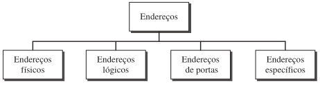

# CONJUNTO DE PROTOCOLOS TCP/IP

O conjunto de protocolos TCP/IP foi desenvolvido antes do modelo OSI. Portanto, as camadas no conjunto de protocolos TCP/IP não correspondem exatamente àquelas do modelo OSI.

O conjunto de protocolos TCP/IP foi definido como tendo quatro camadas: host-rede, internet, transporte e aplicação. Entretanto, quando o TCP/IP é comparado ao modelo OSI, podemos dizer que a camada host-rede é equivalente à combinação das camadas física e de enlace de dados.

> A camada internet equivale à camada de rede e a camada de aplicação realiza, a grosso modo, as funções das camadas de sessão, de apresentação e de aplicação com a camada de transporte no TCP/IP cuidando também de parte das tarefas da camada de sessão.

## Arquitectura

O TCP/IP é um conjunto de protocolos hierárquicos, compostos por módulos interativos,
cada um dos quais provendo funcionalidades específicas; entretanto, os módulos não são necessariamente interdependentes. Enquanto o modelo OSI especifica quais funções pertencem a cada uma de suas camadas, as camadas do conjunto de protocolos TCP/IP contêm protocolos relativamente independentes que podem ser mesclados e combinados dependendo das necessidades do sistema. O termo hierárquico significa que cada protocolo de nível superior é suportado por um ou mais protocolos de nível inferior.

## Camada

Na camada de transporte, o TCP/IP define três protocolos: *Transmission Control Protocol (TCP), User Datagram Protocol (UDP) e Stream Control Transmission Protocol (SCTP)*.\
Na camada de rede, o protocolo principal definido pelo TCP/IP é o Internetworking Protocol (IP);\ 
Existem também outros protocolos que suportam a movimentação de dados nessa camada.

1. **Camadas Física e de Enlace**: O TCP/IP não define nenhum protocolo específico. Ele suporta todos os protocolos-padrão e proprietários
2. **Camada de Rede**: O TCP/IP suporta o Internetworking Protocol (IP).
    - **Internetworking Protocol (IP)**: O Internetworking Protocol (IP) é o mecanismo de transmissão usado pelos protocolos TCP/IP.
3. **Camada de Transporte**: IP é um protocolo host-to-host, significando que ele é capaz de transmitir um pacote de um dispositivo físico a outro. O UDP e o TCP são protocolos do nível de transporte responsáveis pela entrega de uma mensagem de um processo (programa em execução) a outro processo.
4. **Camada de Aplicação**:A camada de aplicação no TCP/IP equivale à combinação das camadas de sessão, de apresentação e de aplicação do modelo OSI. Muitos protocolos são definidos nessa camada.

## ENDEREÇAMENTO

São usados quatro níveis de endereços em uma internet que emprega os protocolos TCP/IP: **endereços físicos** (links), **endereços lógicos** (IP), **endereços de portas e endereços específicos**.

- **Endereços Físicos**: O endereço físico, também conhecido como endereço de link, é o endereço de um nó conforme definido por sua LAN ou WAN.

Os endereços físicos têm autoridade sobre a rede (LAN ou WAN). O tamanho e o formato
desses endereços variam dependendo da rede.

- **Endereços Lógicos**: Os endereços lógicos são necessários para que as comunicações universais sejam independentes das redes físicas subjacentes.

Um endereço lógico na Internet, é um endereço de 32 bits capaz de definir de forma única e exclusiva um host conectado à Internet. Nenhum par de hosts visíveis e com endereços de acesso público na Internet podem ter o mesmo endereço IP.

- **Endereços de Portas**: O endereço IP e o endereço físico são necessários para que um conjunto de dados trafegue de um host origem até o destino.

O objetivo final das comunicações na Internet é de um processo se comunicar com outro.

- **Endereços Específicos**: Algumas aplicações têm endereços amigáveis que são concebidos para um endereço específico.

Entre alguns exemplos, temos endereços de e-mail e a URL (Universal Resource Locator / localizador universal de recursos).\
O primeiro define o destinatário de uma mensagem de e-mail.\
o segundo é usado para encontrar um documento na World Wide Web.\
Esses endereços, porém, são convertidos pelo computador emissor em endereços lógico e de porta correspondentes.

