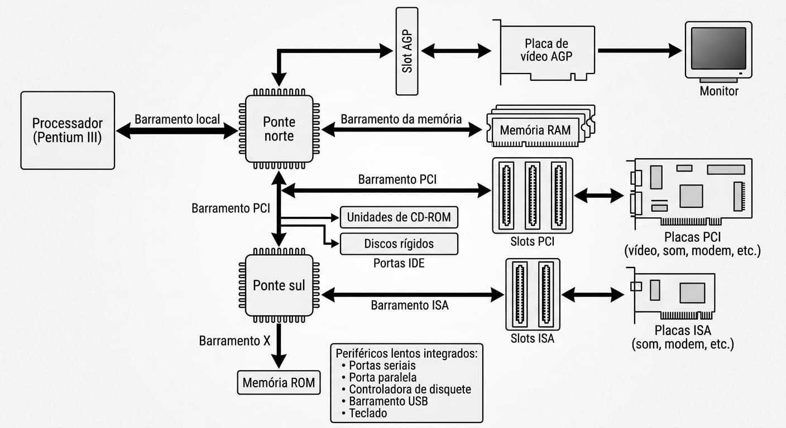

# Arquitetura dos Micros do Padrão PC

Na Figura acima, vemos a arquitetura de um PC moderno típico. Todos os componentes
que ilustrados na Figura, são instalados em uma placa principal, também chamada placa-mãe. 
Nessa placa localizam-se os circuitos de apoio (chipset) e os slots, 
que são conectores para a instalação de placas periféricas, tais como placas de vídeo e placas de
som, além dos conectores para o processador, para a memória RAM, portas seriais, porta paralela, portas USB,
conectores para os discos rígidos e muito mais.

*Referencia bibliografica: Gabriel Torres - Hardware Curso Completo 4ª Edição.*