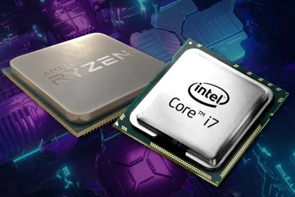
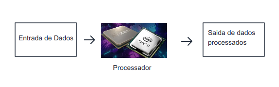
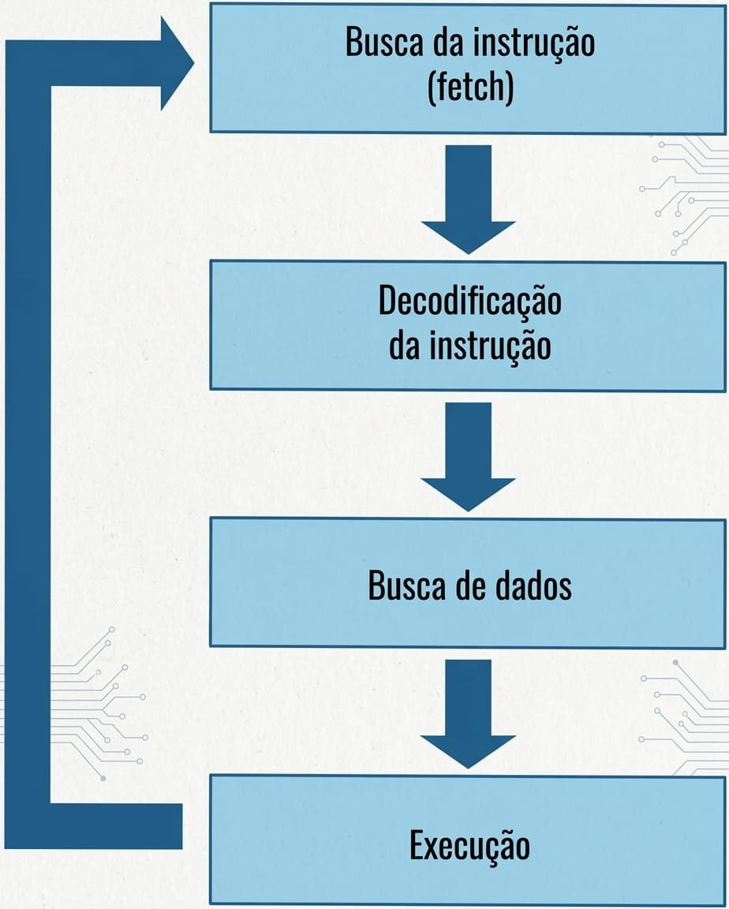
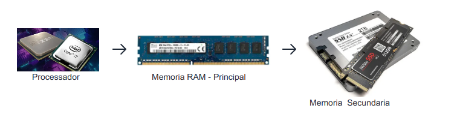

# CPU - Processador



Processadores ou simplesmente CPU (Central Processing Unit), 
são circuitos integrados passíveis de ser programados para executar uma tarefa 
predefinida, basicamente manipulando e processando dados.

Em resumo o papel processador é Receber, Processar e Entregar dados.



OS processadores funcionam atraves de instruções programadas.
Exemplos: 
* Nos fornos de microondas: quando definimos o tempo, temperatura, tipo de alimento, ...
* Nos carros: em seus sistemas de injeção eletrônica, comandam a quantidade de
ar e combustível que devem ser inseridos no motor, de acordo com dados lidos de alguns sensores.
* Nos computadores, que da para fazer muita coisa, inclusive escrever/ler estas anotacoes.

Cada processador tem um conjunto de instruções diferentes.

Porem os processadores usados em computadores, sao processadores de uso geral,
onde nao ha limitacao do que processar ou nao, diferente de um microondas ou controlo remoto para TV.

## Funcionamento dos Processadores

O processador não tem uma grande capacidade interna de armazenamento.
Por isso é necessario um outro componente, chamado memoria, para armazenar os
programas que mais tarde serao executados pelo processador. 

Quando executamos um programa no computador, o processador busca as instruções necessárias na memória RAM. (A casos especias em que
os programas ficam armazenados dentro do processador).
*Programa = conjunto de instrucoes/comadados*.


 
Existem dois tipos de memória principal: RAM (Random Access Memory) e ROM (Read
Only Memory).

* RAM: Permite que os dados presentes sejam modificados (Leitura e Escrita); 
O conteúdo na memória é apagado quando ocorre corte na alimentação.
* ROM: Não permite que os dados presentes sejam modificados (Leitura apenas); 
O conteúdo não é apagado quando ocorre corte na alimentação.

> Sistemas dedicados, como o do controlo remote, usam o armazenamento em memoria ROM, ja que exectuam sempre as mesmas instrucoes (ligar, trocar, volume...).

> Já em computadores, como podemos executar qualquer tipo de programa, a memória principal é do tipo RAM.

Porem a memoria RAM, pode ser pequena para armazenar o programa que necessita ser
executado, ou todos os programas que estão sendo executados ao mesmo tempo, no caso
dos processadores atuais, que permitem o recurso de multitarefa.
Além disso, como comentamos, o conteúdo da RAM é apagado sempre que desligamos o
micro e, com isso, a memória está "vazia" sempre em que ligamos o computador.
Por isso, dados e programas são armazenados em um sistema de memória secundária,
também chamada memória de massa, tais como discos rígidos, CDs-ROM..., onde os dados
não são perdidos quando desligamos o micro. 
Acontece que esses sistemas, por serem de acesso mecânico, têm uma velocidade muito
inferior à do processador

Quando abrimos uma programa, o mesmo e transferido da memoria secundaria para a memoria RAM, e o processador busca as instrucoes do programa na memoria RAM.
O componete capaz de executar instrucoes e o processador.



Na primeira etapa, Busca da Instrução (também conhecida como fetch), o processador busca a instrução na memória. Em seguida, a decodifica, isto é, verifica se é uma instrução válida (presente em seu conjunto de instruções) e o que a mesma faz. 
Em seguida, busca na memória os dados necessários para executar a instrução,
caso esta seja acompanhada de dados. 

Por exemplo, uma hipotética instrução "Some A+B" necessita dos valores de
A e B, que serão buscados na memória nesta etapa. Só então é que a instrução é executada. Após a execução da instrução, o processo começa novamente, com o processador indo na memória buscar a próxima instrução a ser
executada.


## Tipos de processadores

Independentemente da aplicação, todos os processadores trabalham de uma forma muito parecida. Para executarem uma determinada instrução.

### Evolucao dos processadores

[A EVOLUÇÃO DOS PROCESSADORES - By lidiannesousa](https://www.timetoast.com/timelines/a-evolucao-dos-processadores)

*Veja a evolucao no link acima*

---

Os processadores foram inventados na década de 70 por uma empresa chamada Intel. Com o sucesso obtido, várias outras empresas também começaram a construir seus próprios processadores. No início da década de 80, quando estava projetando o seu IBM PC, a IBM decidiu usar processadores da família Intel, mais especificamente um chamado 8088. Outras empresas, que lançaram também computadores pessoais (como a Apple, só para citar a mais conhecida), optaram por criar sua própria linha de computadores, usando outras famílias de processadores, incompatíveis com os processadores da família Intel.

 ``` 
 Nota: Quando falamos “família Intel” queremos dizer “processadores com conjunto de instruções x86, originalmente criado pela Intel”. Processadores atuais como os fabricados pela AMD (que é um outro fabricante de processadores) são da família Intel, já que usam esse conjunto de instruções isto é, são 100 % compatíveis em software com os processadores originalmente criados pela Intel. Portanto, tome o cuidado para não entender equivocadamente esse conceito, achando que somente processadores fabricados pela Intel são da “família Intel”.
 ````

 Os processadores usados nos PCs (ou seja, processadores da família Intel, processadores x86) já passaram de sua 7ª geração, isto é, em sua sétima revisão estrutural. Só é considerada uma nova geração quando há alterações no funcionamento interno do processador. O grande problema para aqueles que não estudam a matéria é que os fabricantes lançam no mercado processadores de mesma geração com diversos nomes comerciais diferentes, levando o usuário a pensar que há muito mais gerações de processadores do que realmente existe.

 O exemplo mais claro disso está nos processadores Pentium II e Pentium III, que são processadores Intel de 6ª geração, funcionando internamente exatamente da mesma maneira, porém sendo vendidos com nomes comerciais diferentes, induzindo ao leigo a achar que o funcionamento de um Pentium III é mais “avançado” do que o funcionamento de um Pentium II, enquanto que, internamente, esses processadores trabalham exatamente da mesma maneira.

 ### Processadores da arquitetura x86

 Para entender a fundo como os processadores funcionam, é necessário o estudo da arquitetura de cada uma das gerações de processadores x86. Em outras palavras, para entender de forma aprofundada o funcionamento interno de um processador Pentium 4, teremos que estudar o funcionamento de todos os processadores anteriores a ele para compreender o que esse processador traz de novo. 
 
 Segue um resumo das sete gerações de processadores x86, seus principais processadores e as principais diferenças em sua arquitetura em comparação com a geração anterior.

```markdown
1ª Geração: Processadores 8086 e 8088. O 8088 foi o primeiro processador usado no PC. Ele é um 8086 “piorado”. Apesar de ser um processador de 16 bits, o 8088 só acessa a memória a oito bits por vez. Isso foi feito porque na época do lançamento do 8086 não existiam circuitos de apoio de 16 bits no mercado, e os existentes eram muito caros, o que faria com que o PC custasse uma fortuna caso tivesse sido usado o 8086 em vez de o 8088.

2ª Geração: Processadores 80286. Introduziu um modo de operação chamado modo protegido, que permitia ao processador acessar até 16 MB de memória RAM, dezesseis vezes mais do que o 8086/ 8088, entre outros recursos, como multitarefa e proteção de memória. Através de um outro modo de operação, chamado modo real, permitia que o processador se comportasse como se fosse um 8086, permitindo executar programas originalmente escritos para o primeiro PC. Esse processador não tinha uma instrução para que o processador voltasse do modo protegido para o modo real e, portanto, não tinha como ser usado na prática. Por isso que o modo protegido do 286 raramente foi usado.

3ª Geração: Processadores 80386. Foi o verdadeiro marco na evolução dos processadores x86. O processador passou a ser de 32 bits e ter um modo protegido que funciona, permitindo o acesso direto a até 4 GB de memória RAM e recursos como multitarefa, proteção de memória, memória virtual e um novo modo de operação chamado virtual 8086 (ou simplesmente v86).  Nesta mesma época foi introduzido o conceito de memória cache, uma memória mais rápida do que a RAM localizada na placa-mãe.

4ª Geração: Processadores 80486. Adicionaram recursos internos para aumentar a velocidade de processamento: o co-processador matemático passou a estar embutido dentro do próprio processador (até o 386 esse circuito era à parte, e você precisava instalá-lo na placa-mãe) e o processador passou a ter uma pequena quantidade de memória cache dentro dele. A partir do 486DX2, os processadores passaram a usar um esquema de multiplicação de clock, como chegamos a comentar anteriormente.  Como você pode perceber, o 486 não passa de um 386 “vitaminado”.

5ª Geração: Processadores Pentium e Pentium MMX. Apesar de serem processadores de 32 bits, a partir da 5ª geração os processadores x86 passaram a usar um barramento de dados de 64 bits, podendo transferir dois dados por vez, aumentando o desempenho. A principal modificação foi o uso da arquitetura superescalar, isto é, o processador passou a ter mais de uma unidade de execução interna. Em português, isso significa que o processador tem, internamente, mais de um processador.

6ª Geração: Processadores Pentium Pro, Pentium II, Pentium III, Celeron, Pentium II Xeon, Pentium III Xeon. Apesar de usarem o nome “Pentium”, são processadores de geração diferente do processador Pentium original (também chamado Pentium clássico). A principal inovação foi o uso de uma arquitetura híbrida CISC/RISC. Outros recursos, como execução fora de ordem e execução especulativa, também foram adicionados. Outra novidade foi a adição do circuito de memória cache que até os processadores de 5ª geração estava na placa-mãe do micro dentro do próprio processador, aumentando o desempenho de processamento. Assim, a partir da 6ª geração os processadores passaram a ter dois caches de memória dentro dele, um chamado nível 1 (L1), adicionado na 4ª geração, e um chamado nível 2 (L2), que era o cache que antes estava localizado na placa-mãe e foi adicionado nesta geração.

7ª Geração: Processadores Pentium 4. A arquitetura interna dos processadores de 7ª geração é baseada na dos processadores de 6ª geração, trazendo modificações importantes para o aumento do desempenho do processador. As principais novidades foram o aumento do desempenho do barramento externo (transferindo quatro dados por pulso de clock, em vez de apenas um, como nos processadores das gerações anteriores), a mudança da arquitetura do cache L1 e a existência de duas unidades de execução trabalhando com o dobro do clock interno do processador.

Processadores IA-64. A primeira geração dessa nova arquitetura é representada pelos processadores Itanium. Sua principal modificação em relação aos demais processadores é usar uma arquitetura RISC pura, chamada IA-64, permitindo a execução de sistemas operacionais de 64 bits. Na realidade, usa uma tecnologia que não é exatamente RISC, chamada VLIW (Very Long Instruction Word). Representa a 2ª mudança real na arquitetura dos processadores x86 — a primeira foi nos processadores de 3ª geração — já que desde o 386 os processadores x86 utilizam basicamente a mesma arquitetura de software. 
```

`A partir da 5ª geração não há como fazer uma correlação direta entre os processadores fabricados pela Intel com os processadores fabricados por outras empresas.`

*Referencia bibliografica: Gabriel Torres - Hardware Curso Completo 4ª Edição.*