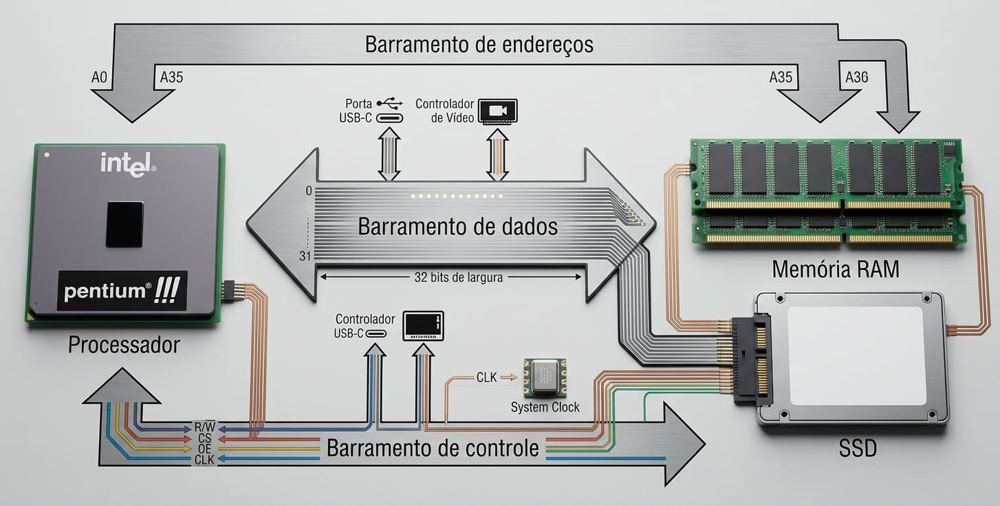
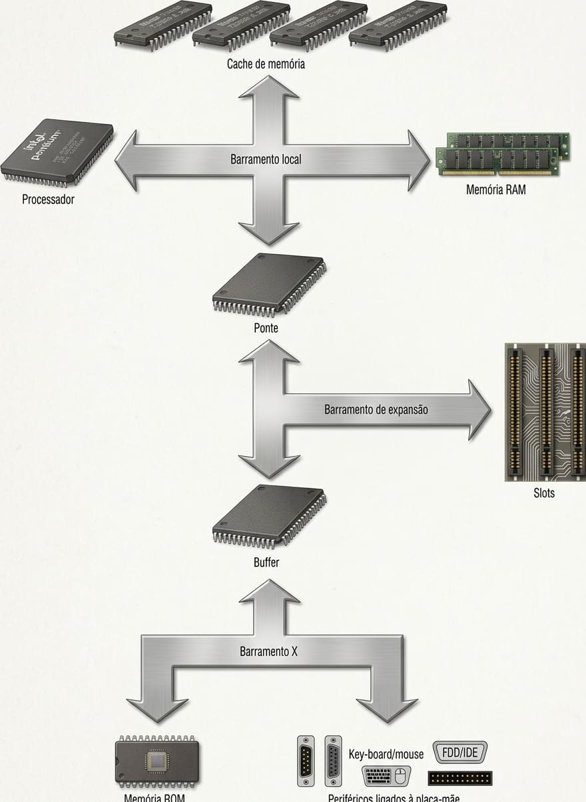

# Barramentos

Barramento é um sistema de comunicação que transfere dados entre componentes dentro de um computador, ou entre computadores.

De uma maneira bem simples, poderíamos dizer que um barramento é uma via de comunicação.

O principal barramento do micro é o barramento local, a via de comunicação que conecta o processador aos circuitos primordiais da placa-mãe: a memória RAM, a memória cache L2 e o chipset.

Damos o nome de chipset ao conjunto de circuitos integrados de apoio existentes na placa-mãe. Dentre os diversos circuitos presentes no chipset, destacamos o controlador de memória (RAM) e o controlador de cache — além do controlador de barramento, no caso de existirem outros barramentos no micro, o que certamente ocorre.

Podem ser divididos em três grupos:

* Barramento de dados: É por onde os dados circulam.
* Barramento de endereços: É por onde a informação de endereço é fornecida.
* Barramento de controle: Informações adicionais como, por exemplo, se a operação é de leitura ou escrita.



Se o processador quiser armazenar o dado 10101100b no endereço 5h (como exemplificamos anteriormente na Figura 1.13), deverá colocar, no barramento de dados, o valor do dado (10101100b), no barramento de endereços, o valor do endereço (5h) e, no barramento de controle, confirmar que se trata de uma operação de escrita em memória. Tudo isso é feito simultaneamente.

```
Nota: A Figura acima é uma representação teórica, já que na prática o processador não se comunica diretamente com a memória RAM, mas sim com o chipset da placa-mãe (Ponte Norte).
```

Muitas vezes todos os circuitos presentes em um barramento são conectados em paralelo. 
Isso significa que todos os circuitos recebem a mesma informação ao mesmo tempo. Por exemplo, em um micro com uma placa de som PCI e uma placa de vídeo PCI, essas duas placas recebem as mesmas informações ao mesmo tempo. Mas graças à
existência do barramento de endereço e do barramento de controle, os circuitos são capazes de saber para quem é o dado que está circulando no barramento de dados. Assim, a placa de vídeo sabe que um dado é destinado a ela, capturando este dado, enquanto que a placa de som fica inoperante, já que sabe que o dado não é para si.

## Modelos de barramentos de expansão

O barramento local é o mais rápido, pois os circuitos se comunicarão com o processador em seu desempenho máximo. Entretanto, o barramento local não é padronizado: cada processador deverá utilizar o seu próprio modelo,
de acordo com as suas características.

Para que uma simples placa de vídeo ou um disco rígido possam ser utilizados em qualquer micro, independentemente do processador instalado (ou seja, independentemente do modelo de barramento local empregado), utilizamos diversos modelos de barramentos de expansão. Dentre eles, podemos destacar:

* ISA (Industry Standard Architecture).
* EISA (Extended Industry Standard Architecture).
* VLB (VESA Local Bus).
* PCI (Peripheral Component Interconnect).
* AGP (Accelerated Graphics Port).
* AMR (Audio and Modem Riser).
* CNR (Communications and Network Riser).
* USB (Universal Serial Bus).
* FireWire (também chamado IEEE 1394).
* IrDA (Infrared Developers Association).

Todos esses modelos de barramento são disponibilizados na placa-mãe do micro, através de conectores, chamados slots. A exceção fica por conta dos barramentos USB, FireWire e IrDA, que são externos ao micro.



A princípio, pode parecer que, se o micro tiver esses periféricos integrados à própria placa-mãe, estarão trabalhando à mesma velocidade da placa-mãe (Isto é, à mesma velocidade do barramento local). Porém, isso
não é verdade. No projeto de placas-mãe integradas, ou seja, com periféricos on-board, normalmente os periféricos integrados comunicam-se com o processador através de uma extensão do barramento de expansão,
chamado barramento X (eXtension bus) — ou seja, mesmo o periférico estando integrado na placa-mãe, é tratado como se estivesse conectado a um dos slots de expansão. Por exemplo, todas as placas-mãe atualmente tem portas IDE para a conexão de discos rígidos. Essas portas são ligadas ao barramento PCI e não ao
barramento local, como poderíamos supor.

### Barramento local

O barramento local é utilizado na comunicação do processador com os circuitos básicos e que demandam velocidade (especialmente a memória RAM e o cache de memória L2, no caso de placas-mãe que tenham este circuito) e este é o barramento mais rápido encontrado em um PC.

## Taxa de transferência 

``` 
    Taxa de transferência = freqüência de operação x número de bits / 8 
```

No caso do barramento local típico de 64 bits a 66 MHz, a taxa de transferência máxima entre o processador e a memória (RAM e cache) será de 528 MB/s (64 bits x 66 milhões / 8). 

A divisão por oito é utilizada para obtermos o resultado em bytes e não em bits. No caso do barramento operar a 100 MHz, a taxa de transferência será de 800 MB/s, e assim sucessivamente. Basta usar a fórmula para calcular a taxa de transferência.

A conta leva em consideração que o processador transfere somente um dado por pulso de clock.

### Tabela para diversas freqüências de operação do barramento local

A seguir, a tabela e o gráfico (Figura 10.3) mostram as taxas de transferência para diversas freqüências de operação do barramento local, considerando-se processadores a partir do Pentium, que acessam a memória a 64 bits. As freqüências "2x" indicam a transferência de dois dados por pulso de clock (processadores Duron e
Athlon) e a freqüência "4x" indica a transferência de quatro dados por pulso de clock (processadores Intel de 7ª geração, como o Pentium 4).

| Freqüência de barramento local | Taxa de transferência máxima |
|---|---|
| 50 MHz | 400 MB/s |
| 55 MHz | 440 MB/s |
| 60 MHz | 528 MB/s |
| 75 MHz | 600 MB/s |
| 83 MHz | 664 MB/s |
| 100 MHz | 800 MB/s |
| 133 MHz | 1.064 MB/s |
| 100 MHz 2x | 1.600 MB/s |
| 133 MHz 3x | 2.128 MB/s |
| 100 MHz 4x | 3.200 MB/s |

Nota: Os valores de taxa de transferência estão arredondados, pois, em vez de dividir-se o resultado do cálculo por 220 para obter-se a taxa em MB/s, dividiu-se por 10<sup>6</sup>.

## Barramento ISA (Industry Standard Architecture)

O **ISA** foi o primeiro barramento de expansão dos PCs, criado pela **IBM** em 1981 para o IBM PC (modelo 5150). O nome "ISA" foi cunhado depois, no final dos anos 1980, pelos fabricantes de clones como resposta à tentativa da IBM de substituir o barramento AT pela arquitetura Micro Channel.

### Evolução

| Versão | Ano | Largura | Clock | Taxa máx. |
|---|---|---|---|---|
| PC bus (8-bit) | 1981 | 8 bits | 4,77 MHz | ~4 MB/s |
| AT bus (16-bit) | 1984 | 16 bits | 6–8 MHz | ~8 MB/s |
| EISA (32-bit) | 1988 | 32 bits | 8–10 MHz | ~33 MB/s |

### Características principais

- **Tipo:** barramento paralelo, síncrono com o clock da CPU (originalmente)
- **Conector:** 62 pins (8-bit) ou 98 pins (16-bit) em formato edge connector
- **Endereçamento:** até 16 MB de memória RAM (24 bits de endereço)
- **DMA:** 4 canais de 8 bits + 3 canais de 16 bits
- **IRQs:** até 15 linhas de interrupção (IRQ0–IRQ15)
- **Dispositivos:** até 6 placas de expansão simultâneas
- **Plug and Play:** adicionado em 1993 pela Intel e Microsoft

### Limitações e substituição

- Velocidade baixa frente ao desempenho crescente das CPUs
- Configuração manual de IRQ/DMA (jumpers), sujeita a conflitos
- Apenas 16 MB endereçáveis por bus mastering
- Substituído pelo **PCI** a partir de 1993 e pelo **PCI Express** nos anos 2000

O ISA permaneceu como padrão de fato nos PCs compatíveis com IBM PC durante toda a década de 1980 e início dos anos 1990, sendo essencial para a democratização dos computadores pessoais graças à publicação aberta das especificações pela IBM.

---

## Barramento AGP (Accelerated Graphics Port)

O **AGP** foi um barramento dedicado para placas de vídeo, desenvolvido pela Intel em 1996 e lançado comercialmente em agosto de 1997 com o chipset i440LX. Ele substituiu o uso do barramento PCI para gráficos, oferecendo um canal **ponto-a-ponto** direto entre a GPU e a memória RAM.

### Versões

| Versão | Ano | Velocidade | Clock | Tensão | Largura de banda |
|---|---|---|---|---|---|
| AGP 1.0 (1×) | 1997 | 1× | 66 MHz | 3,3 V | 266 MB/s |
| AGP 1.0 (2×) | 1997 | 2× | 66 MHz | 3,3 V | 533 MB/s |
| AGP 2.0 (4×) | 1998 | 4× | 66 MHz | 1,5 V | 1.066 MB/s |
| AGP 3.0 (8×) | 2002 | 8× | 66 MHz | 0,8 V | 2.133 MB/s |

### Características principais

- **Largura:** 32 bits (4 bytes)
- **Dispositivos:** 1 por slot (dedicado)
- **Acesso direto à RAM (DART):** permite que a GPU acesse a memória do sistema para texturas sem passar pela memória local da placa
- **Pipelining:** suporta até 256 requisições simultâneas em pipeline, reduzindo a latência
- **Fast Write (AGP 2.0+):** otimiza a escrita de dados de vídeo
- **Sinalização:** half-duplex, com *pumping* (1×, 2×, 4×, 8×) para multiplicar a taxa efetiva

### Vantagens sobre o PCI

| | AGP | PCI 33 MHz |
|---|---|---|
| Clock | 66 MHz | 33 MHz |
| Banda máxima | 2.133 MB/s (8×) | 133 MB/s |
| Acesso à memória | Direto (DART) | Compartilhado |
| Dispositivos | 1 (dedicado) | Múltiplos (compartilhado) |

### Fim de vida

- **2004:** PCI Express começa a substituir o AGP
- **2010:** praticamente nenhum chipset novo suporta AGP
- **2016:** Windows 10 (versão 1607) remove o suporte a AGP

O AGP marcou a transição dos PCs para a era da aceleração 3D, sendo essencial para o desempenho de jogos e aplicações gráficas entre o final dos anos 1990 e o início dos anos 2000.

---

## Barramento PCI (Peripheral Component Interconnect)

O **PCI** foi desenvolvido pela Intel em 1992 como um barramento de expansão **síncrono, paralelo e independente da CPU**, substituindo o ISA. A gestão do padrão passou depois para o PCI-SIG (PCI Special Interest Group).

### Versões

| Versão | Ano | Mudança principal |
|---|---|---|
| PCI 1.0 | 1992 | Lançamento original (32 bits, 33 MHz, 5 V) |
| PCI 2.0 | 1993 | Especificação de conectores e cards; slots 3,3 V |
| PCI 2.1 | 1995 | Operação opcional a 66 MHz |
| PCI 2.2 | 1998 | Correções e melhorias de legibilidade |
| PCI 2.3 | 2002 | Remoção de cards apenas 5 V |
| PCI 3.0 | 2004 | Última revisão; remove suporte a conector 5 V |

### Características principais

- **Largura:** 32 bits (padrão) ou 64 bits (extensão)
- **Clock:** 33 MHz (padrão) ou 66 MHz (revisão 2.1+)
- **Tensão:** 5 V (inicial) ou 3,3 V (revisão 2.0+)
- **Taxa de transferência máxima:**
  - 32 bits @ 33 MHz → **133 MB/s**
  - 64 bits @ 66 MHz → **533 MB/s**
- **Endereçamento:** até 4 GB em cada espaço de memória e I/O (32 bits)
- **Dispositivos:** até 10 cards simultâneos (compartilhados no mesmo barramento)
- **Bus mastering:** dispositivos podem iniciar transferências sem intervenção da CPU
- **Plug and Play:** suporte nativo a partir da revisão 2.0

### Comparação com outros barramentos

| | ISA (AT) | PCI 33 | PCI 66 | PCI Express 1.0 x16 |
|---|---|---|---|---|
| Largura | 16 bits | 32 bits | 64 bits | 16 lanes |
| Clock | 8 MHz | 33 MHz | 66 MHz | 2.5 GHz |
| Banda máx. | 8 MB/s | 133 MB/s | 533 MB/s | 8.000 MB/s |
| Tipo | Paralelo, compartilhado | Paralelo, compartilhado | Paralelo, compartilhado | Serial, ponto-a-ponto |

### Limitações

- **Barramento compartilhado:** todos os dispositivos disputam a mesma banda; adicionar cards reduz a performance de todos
- **Sensibilidade a skew:** a largura paralela torna o sinal vulnerável a distorções em altas frequências
- **Escalabilidade limitada:** não há como aumentar a banda sem alterar a arquitetura
- **EMI/crosstalk:** cresce exponencialmente com a frequência

### Evolução

| Sucessor | Ano | Diferença |
|---|---|---|
| PCI-X | 1999 | 64 bits a 133 MHz → 1.066 MB/s |
| PCI Express | 2003/2004 | Serial, ponto-a-ponto, full-duplex |

O PCI dominou os PCs e servidores entre 1994 e meados dos anos 2000, sendo gradualmente substituído pelo PCI Express, que resolveu as limitações de banda e escalabilidade do barramento paralelo.

---

## Barramento PCIe (PCI Express)

O **PCIe** é um barramento de expansão **serial, síncrono e ponto-a-ponto**, desenvolvido pela PCI-SIG (PCI Special Interest Group) e lançado em 2003. Ele substituiu o PCI paralelo, oferecendo escalabilidade por *lanes* (faixas) e compatibilidade reversa entre gerações.

### Arquitetura

- **Tipo:** serial, full-duplex, ponto-a-ponto
- **Lanes (faixas):** cada conexão é composta por 1, 2, 4, 8 ou 16 lanes (x1, x2, x4, x8, x16)
- **Largura por lane:** 1 bit diferencial (Tx) + 1 bit diferencial (Rx)
- **Encodamento:**
  - Gen 1–5: NRZ (Non-Return-to-Zero)
  - Gen 6+: PAM4 (Pulse Amplitude Modulation, 4 níveis) + FLIT mode + FEC
- **Full-duplex:** cada lane transmite e recebe simultaneamente

### Gerações

| Versão | Ano | Data rate | x1 | x4 | x16 (unidirecional) | x16 (bidirecional) |
|---|---|---|---|---|---|---|
| PCIe 1.0 | 2003 | 2.5 GT/s | 250 MB/s | 1 GB/s | 4 GB/s | 8 GB/s |
| PCIe 2.0 | 2007 | 5 GT/s | 500 MB/s | 2 GB/s | 8 GB/s | 16 GB/s |
| PCIe 3.0 | 2010 | 8 GT/s | 1 GB/s | 4 GB/s | 16 GB/s | 32 GB/s |
| PCIe 4.0 | 2017 | 16 GT/s | 2 GB/s | 8 GB/s | 32 GB/s | 64 GB/s |
| PCIe 5.0 | 2019 | 32 GT/s | 4 GB/s | 16 GB/s | 64 GB/s | 128 GB/s |
| PCIe 6.0 | 2022 | 64 GT/s (PAM4) | 8 GB/s | 32 GB/s | 128 GB/s | 256 GB/s |
| PCIe 7.0 | 2025 | 128 GT/s (PAM4) | 16 GB/s | 64 GB/s | 256 GB/s | 512 GB/s |
| PCIe 8.0 (draft) | ~2028 | 256 GT/s | 32 GB/s | 128 GB/s | 512 GB/s | 1 TB/s |

> *GT/s = gigatransfers per second (gigatransferências por segundo)*

### Novidades por geração

| Geração | Mudança principal |
|---|---|
| 1.0–2.0 | NRZ, 8b/10b (Gen 1) e 8b/10b (Gen 2) encoding |
| 3.0 | 128b/130b encoding — maior eficiência espectral |
| 4.0–5.0 | Mesma codificação, apenas dobra de clock |
| 6.0 | **PAM4** (2 bits/símbolo), **FLIT mode** (pacotes fixos de 256 B), **FEC** (Forward Error Correction) |
| 7.0 | PAM4 + FLIT mantidos; melhora eficiência energética; suporte a interconexões ópticas |

### Formatos de slot

| Formato | Lanes | Uso típico |
|---|---|---|
| x1 | 1 | Wi-Fi, som, rede |
| x4 | 4 | SSDs M.2/NVMe, captura de vídeo |
| x8 | 8 | GPUs intermediárias, HBA |
| x16 | 16 | GPUs de alto desempenho, HPC |

### Vantagens sobre o PCI paralelo

| | PCI (paralelo) | PCIe 3.0 x16 |
|---|---|---|
| Banda máx. | 133 MB/s (32b/33MHz) | 16 GB/s |
| Topologia | Compartilhado (bus) | Ponto-a-ponto |
| Full-duplex | Não | Sim |
| Escalabilidade | Limitada | x1 a x16 |
| Sinalização | Paralela (skew) | Serial diferencial (imune a ruído) |

### Aplicações atuais (2026)

- **GPUs:** PCIe 5.0 x16 (NVIDIA RTX 40/50, AMD RX 7000/8000)
- **SSDs NVMe:** PCIe 4.0 x4 (até 8 GB/s) e PCIe 5.0 x4 (até 14 GB/s)
- **AI/HPC:** PCIe 6.0 em aceleradores de data center
- **Rede:** NICs 100G/200G em PCIe 5.0 x16

### Compatibilidade

O PCIe é **totalmente compatível reversível**: um card x4 funciona em um slot x16 (operando a x4), e um card Gen 3 funciona em um slot Gen 5 (operando a Gen 3). A velocidade é sempre a do componente mais lento do par.

---

O PCIe é o padrão dominante de expansão em PCs, servidores e data centers desde 2004, e a PCI-SIG mantém o compromisso de dobrar a banda a cada ~3 anos, com a Gen 8 já em fase de especificação para lançamento em 2028.