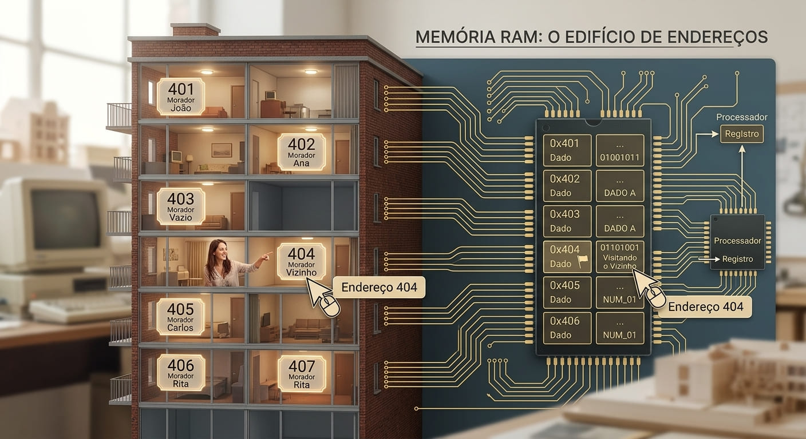
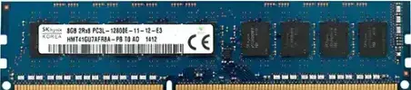
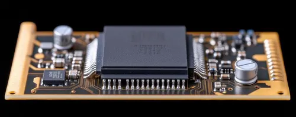
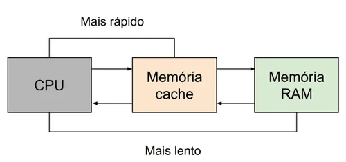

# Memória

Internamente a memória é dividida em pequenas áreas, chamadas **endereços**. 

Imagine um edifício. Um edifício é dividido em n apartamentos. Para diferenciarmos cada apartamento, atribuímos números.
Assim como podemos visitar o nosso vizinho que mora no apartamento 404, podemos ver um dado que se encontre no endereço 404.



``` 
Dizer que uma memória é de 1 MB significa dizer que ela tem 1 M de endereços que armazenam 1 byte cada. 

Como 1 M = 2^20 = 1.048.576, teremos essa quantidade de endereços para armazenarmos um dado de 8 bits em cada um.
```

Uma vez que a memória é um elemento externo ao processador, dizer que um processador pode acessar ("endereçar") 1 MB de memória não significa que ele terá 1 MB de memória; significa que o microprocessador é capaz de enxergar até 1.048.576 lugares diferentes para armazenar dados de 8 bits.

```
Apesar de os processadores a partir da 3ª geração (386) permitirem o acesso a até 4 GB de memória RAM, a quantidade
máxima de memória que podemos ter em um micro depende da placa-mãe, porque é no chipset (conjunto de
circuitos da placa-mãe) que está embutido um circuito chamado Controlador de Memória, que gerencia o acesso à
memória RAM. Esse circuito também tem um limite de acesso à memória RAM. Dessa forma, se a placa-mãe tem
um chipset que acessa no máximo 512 MB de memória RAM, você só poderá ter, no máximo, 512 MB de memória
RAM no micro, embora o processador consiga acessar bem mais do que isso.
```

## Tipos de Memoria

Quando usamos o termo "memória", normalmente estamos nos referindo à memória RAM do micro. Esse tipo de memória é onde o processador busca instruções para serem processadas.

### RAM



A RAM (Random Access Memory) é um tipo de circuito eletrônico de memória que permite a leitura e a escrita de
dados em seu interior. Só que ela é uma memória volátil, isto é, cortando-se sua alimentação elétrica, apagamos os
dados que estavam nela armazenados.

Por exemplo em uma calculadora, quando a desligamos, perdemos o dado
que estava sendo exibido no visor, mostrando "0" quando a religamos. É por esse motivo que devemos usar
sistemas de memória de massa (discos rígidos, CDs-ROM, disquetes, etc.) para armazenarmos dados e programas.

### ROM



A memória ROM (Read Only Memory) é um circuito eletrônico de memória onde os seus dados não podem ser modificados, isto é, o seu conteúdo é sempre o mesmo. Em compensação, o conteúdo dessa memória não é perdido quando cortamos a sua alimentação.

Quando ligamos o micro, o processador não sabe o que fazer; ele precisa ser programado. O programa necessário para dar partida no micro é gravado em uma memória ROM, que está localizada na placa-mãe do computador.

Assim, quando ligamos o micro, o processador lê e executa o programa que está localizado na memória ROM do computador.
Um programa (software), quando armazenado em ROM, recebe o nome de **firmware**. 
Dentro da memória ROM do micro, há basicamente três programas (firmwares):

1. **BIOS (Basic Input/Output System, Sistema Básico de Entrada/Saída)**: ―Ensina‖ o processador a trabalhar com os periféricos mais básicos do sistema, tais como os circuitos de apoio, a unidade de disquete e o vídeo em modo texto.

2. **POST (Power-On Self-Test, Autoteste ao Ligar)**: Um autoteste feito sempre que ligamos o micro. Você já deve ter reparado que, ao ligar o micro, há um teste de memória feito pelo POST. O POST executa as seguintes
rotinas, sempre que o micro é ligado:

* Identifica a configuração instalada.
* Inicializa todos os circuitos periféricos de apoio (chipset) da placa-mãe.
* Inicializa o vídeo.
* Testa a memória.
* Testa o teclado.
* Carrega o sistema operacional para a memória.
* Entrega o controle do microprocessador ao sistema operacional.

3. Setup (Configuração): Programa de configuração de hardware do microcomputador;

Atualmente, usamos a nomenclatura **BIOS** como algo genérico, podendo ser interpretado como *"tudo que está na memória ROM do micro".*

Atualmente há duas tecnologias básicas para a construção de circuitos de memória ROM:

* Mask ROM: Essa é a tecnologia mais tradicional e usada até o lançamento das primeiras placas-mãe soquete 7
Esse tipo de circuito vem programado de fábrica e não há como reprogramá-lo, a não ser
trocando o circuito da placa.

* Flash ROM: Essa é a tecnologia mais moderna para circuitos de memória ROM, pois permite que o circuito
seja reprogramado eletronicamente, isto é, usando o próprio computador. Com isso, você mesmo pode reprogramar um circuito de memória ROM sem a necessidade de trocar peças, como é o caso do upgrade de BIOS em placas-mãe mais modernas.

### Cache

O processador consegue ser bem mais rápido do que a memória RAM. Embora esse problema não importasse muito na época dos primeiros PCs, começou a ser um inconveniente e tanto a partir do processador 386. A solução adotada na maioria das vezes era fazer com que o processador esperasse o tempo necessário para que a lenta
memória RAM ficasse pronta para receber novos dados. 

Essa técnica chamada **wait states** — diminui o desempenho do micro, pois o processador passará boa parte do tempo ocioso, esperando a memória RAM ficar pronta para receber ou entregar dados.

Uma outra solução mais inteligente é a utilização de uma pequena quantidade de memória RAM de alto desempenho, chamada memória estática (o circuito que forma a memória RAM do micro é chamado memória dinâmica), como intermediária na leitura e escrita de dados na memória RAM. Com isso, o micro ganha desempenho, pois o processador é capaz de trocar dados com a memória estática em sua velocidade máxima.

Um circuito chamado Controlador de Cache (tradicionalmente embutido no chipset da placa-mãe) copia os dados que acredita que o processador precisará, da memória RAM para o cache de memória. 
Assim, em vez de ter de buscar os dados na memória RAM, que é um caminho lento, pois usa wait states, o processador lê a cópia dos dados localizada no
cache de memória, que é um caminho bem mais rápido.



A partir dos processadores de 4ª geração (486), os processadores passaram a conter uma pequena quantidade de memória estática em seu interior. 

Esse cache interno é também conhecido como cache nível 1, ou simplesmente **L1 (Level 1)**. A memória estática que compõe o cache de memória, passou a ser chamada memória cache externa, nível 2, ou simplesmente **L2 (Level 2)**. 

Até os processadores de 5ª geração (Pentium e Pentium MMX) essa memória cache está fisicamente localizada na placa-mãe.

## Uso da Memoria

O processador 8088 usado nos primeiros PCs era capaz de "enxergar" somente 1 MB de memória. Essa área de 1 MB foi dividida em 16 áreas menores de 64 KB cada. Para manter compatibilidade com programas mais antigos (e, principalmente, com periféricos mais antigos), os micros atuais continuam com a mesma estrutura do PC original
no primeiro megabyte de memória. Portanto, em seu PC com 64 MB de memória RAM, o primeiro megabyte continua sendo dividido, usado e acessado como no primeiro PC. Essa área é dividida da seguinte forma:

### Mapa da memoria usado pelos PCs no primeiro megabyte de memoria

| Área de Memória | Endereços | Conteúdo |
|---|---|---|
| 0 a 640 KB | `0000h` a `9FFFFh` | Banco 0 ao banco 9 – Memória Convencional |
| 640 a 704 KB | `A0000h` a `AFFFFh` | Banco 10 – Memória de Vídeo |
| 704 a 768 KB | `B0000h` a `BFFFFh` | Banco 11 – Memória de Vídeo |
| 768 a 832 KB | `C0000h` a `CFFFFh` | Banco 12 – ROM da placa de vídeo |
| 832 a 896 KB | `D0000h` a `DFFFFh` | Banco 13 – Firmware de interfaces |
| 896 a 960 KB | `E0000h` a `EFFFFh` | Banco 14 – Firmware de interfaces |
| 960 a 1.024 KB | `F0000h` a `FFFFh` | Banco 15 – BIOS (e Basic residente, caso haja) |


## Mapa de memória — PC moderno (UEFI), 8 GB

Num PC moderno (UEFI) com **8 GB de RAM**, o mapa de memória é muito mais extenso. O primeiro MiB mantém a estrutura legacy por compatibilidade, mas a maior parte da RAM vive acima de 4 GiB.


| Endereço | Tamanho | Tipo | Conteúdo |
|---|---|---|---|
| `0x00000` – `0x003FF` | 1 KB | RAM | Tabela de Vetores de Interrupção (IVT) |
| `0x00400` – `0x004FF` | 256 B | RAM | BIOS Data Area (BDA) |
| `0x00500` – `0x9FBFF` | ~638 KB | RAM | Memória Convencional (livre) |
| `0x9FC00` – `0x9FFFF` | 1 KB | RAM | EBDA (Extended BIOS Data Area) |
| `0xA0000` – `0xBFFFF` | 128 KB | Vídeo | Framebuffer VGA (legacy) |
| `0xC0000` – `0xC7FFF` | 32 KB | ROM | Vídeo BIOS (legacy) |
| `0xC8000` – `0xEFFFF` | ~160 KB | Reservado | Option ROMs / reservado |
| `0xF0000` – `0xFFFFF` | 64 KB | ROM | Firmware UEFI (região legacy) |
| `0x00100000` – ~`0xDF000000` | ~3,4 GB | RAM | **Memória estendida** (usável pelo SO) |
| ~`0xDF000000` – `0xE0000000` | ~16 MB | Reservado | Hole de chipset / ACPI tables |
| `0xE0000000` – `0xF0000000` | 256 MB | Reservado | PCI Express MMIO (barra de memória) |
| `0xF0000000` – `0xFEC00000` | ~12 MB | Reservado | MMIO / NVRAM / firmware |
| `0xFEC00000` | 4 KB | Reservado | I/O APIC |
| `0xFED00000` | 1 KB | Reservado | HPET |
| `0xFEE00000` | 4 KB | Reservado | Local APIC |
| `0xFFF00000` – `0xFFFFFFFF` | 1 MB | Reservado | Firmware UEFI remapeado (page tables, etc.) |
| `0x100000000` – ~`0x1FF800000` | ~3,95 GB | RAM | **RAM acima de 4 GiB** (usável pelo SO) |
| ~`0x1FF800000` – `0x200000000` | ~8 MB | Reservado | ME Stolen Memory (Intel Manageability Engine) |

### Diferenças principais face ao mapa antigo

- **Acima de 1 MiB** já não há "banco 10, 11, 12…" — a RAM é contínua e o SO (via E820/ACPI) descobre o que está livre.
- O **buraco de 640 KB–1 MB** continua a existir por compatibilidade (VGA, option ROMs).
- O **buraco de 256 MB** (`0xE0000000`–`0xF0000000`) é para PCI Express MMIO.
- A maior parte dos 8 GB vive **acima de 4 GiB** (`0x100000000`+), acessível em modo 64 bits.
- O firmware (UEFI) fica mapeado em **dois sítios**: na região legacy (`0xF0000`) e remapeado no topo do espaço de 4 GiB (`0xFFF00000`).
- No topo da memória física pode haver **stolen memory** para a Intel ME ou para o GPU.

> Num PC real, os valores exatos variam consoante o chipset, a quantidade de PCI devices e o firmware. Podes ver o mapa exato do teu sistema no Linux com `cat /proc/iomem` ou `dmesg | grep -i e820`.